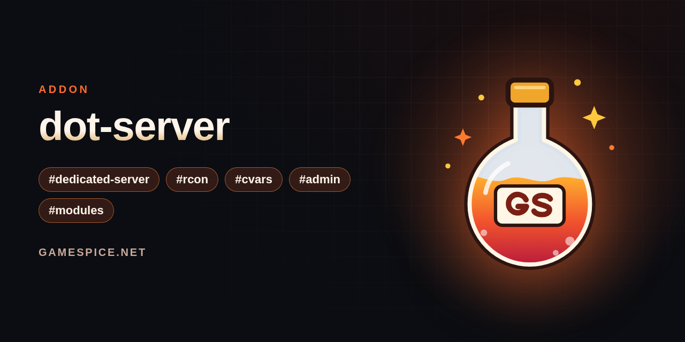

[](https://moddingcommunity.com/a/14-gs-server)

A console-driven dedicated server for Godot 4. It is the piece a server owner runs: console variables and commands, RCON, admin permissions with immunity, bans and mutes, hot-loadable modules, and switching games while players stay connected.

## Install

1. Get [Godot 4.7](https://godotengine.org/download).
2. Either use [GameSpice Bootstrap](https://github.com/gamespice-platform/bootstrap), which clones every project and links the addons, or copy `addons/dot_core/` and `addons/dot_server/` into your project and enable both in *Project > Project Settings > Plugins*.

## Run a server

```gdscript
var server := GSServer.new()
server.config = GSServerConfig.new()
server.config.hostname = "My Server"
server.config.port = 27015
server.config.rcon_password = "something-long"
add_child(server)
```

Or headless, the usual way to run a dedicated server:

```bash
<godot> --headless --path . res://server.tscn -- \
    --sv-port 27015 --sv-hostname "My Server" +sv_maxplayers 24 +changelevel dm_box
```

`--sv-*` sets configuration and `+command` runs a console command. `DOT_SERVER_*` environment variables work too, which suits a systemd unit or container. To start one without learning any of this, use [GameSpice Serve](https://github.com/gamespice-platform/serve).

Threaded work (snapshots, NPCs) uses `sv_worker_threads` workers: -1 (default) is the core count less one, at most `sv_worker_threads_auto_max` (default 8, 0 = no cap); 0 keeps everything on the main thread.

## Connect a client

```gdscript
var link := GSClientLink.new()
add_child(link)
link.player_name = "Ada"
link.phase_changed.connect(func(_p, text): status.text = text)
link.spawned.connect(func(): ui.show_game())

await link.connect_to_server("wss://play.example.com/game")
```

The client downloads the content the current game needs (via GameSpice Cloud), loads the scene the server names and reports ready. The join flow is handled for you.

## Features

| Feature | What you get |
| --- | --- |
| Console | `GSConVar`s with familiar flags: `FLAG_CHEAT` (needs `sv_cheats`), `FLAG_PROTECTED` (never printed, not even in the log), `FLAG_STARTUP_ONLY` (locked once listening), `FLAG_ARCHIVE` (saved by `writeconfig`). Config files with search paths, a command buffer with `wait`, aliases, tab completion and "did you mean" on typos. |
| RCON | The classic RCON wire protocol, so existing clients and panels work. Constant-time password comparison, per-address lockout, optional allow-list, and a WebSocket variant for browser panels. |
| Permissions | String flags rather than fixed roles, and numeric immunity so admins cannot kick each other. Admins come from a JSON file, GameSpice Auth site groups or your own source, all merged. |
| Moderation | Bans by account and by address with durations (`30m`, `2h`, `7d`), mutes and gags, and an append-only JSONL audit log flushed per entry. |
| In-game moderation | `/ban`, `/kick`, `/banip`, `/unban`, `/mute`, `/gag`, `/banlist` and `/whois` run from chat with the speaker's own permissions, flags and audit trail. Name a player as `#12`, a name or part of one, a username, an account id, `ip:203.0.113.9` (everybody at that address) or `@me`. |
| Connections per address | `sv_max_connections_per_ip`, off by default (0). Loopback is never limited. |
| Game switching | Announce, wait for everyone to download the new content, swap, respawn. A failed change restores the previous game. |
| Modules | Subclass `GSModule`, register commands and event hooks, and `module_unload` undoes them. Events have cancellable pre-hooks. |

### Games and maps

A game's `GSGameDescriptor` can name `dependencies` (packs the server and every client mount), `server_dependencies` (server only, never sent to a client) and `maps` (pinned `<owner>/<map>@<version>` keys, fetched when the server changes to one). Read them back with `current_server_dependencies()` and `current_maps()` on `GSGameManager`.

A game calls `GSGameManager.set_current_map("surf_mesa")` when its map changes. `reported_map()` is what server queries report as the map, falling back to the game's display name. It clears when the game unloads.

## Optional addons

None are imported. GameSpice Server works without any of them.

| Addon | With it | Without it |
| --- | --- | --- |
| [GameSpice Auth](https://github.com/gamespice-platform/auth) | Real player identity, so bans mean something and site groups grant permissions. | Everyone is a guest. |
| [GameSpice Cloud](https://github.com/gamespice-platform/cloud) | Downloadable game content. | Games ship inside the build. |
| [GameSpice Moderation](https://github.com/gamespice-platform/moderation) | Bans, mutes and gags kept in a store shared between servers, enforced at connect. | `GSBanManager`'s own list is the ban list. |
| [GameSpice Server Query](https://github.com/gamespice-platform/server-query) | Answers server-list queries (A2S and the GS query protocol). Add a `GSQueryHost`. | The server answers nothing on the query port. |

## Testing

Import the project once, then run `examples/dedicated_server.tscn` headless with Godot. Add `-- --serve` to run it as a real server instead.

## Status and licence

Part of the [**GameSpice**](https://gamespice.net) platform: a family of Godot addons, alongside [GameSpice Core](https://github.com/gamespice-platform/core), [GameSpice Auth](https://github.com/gamespice-platform/auth) and [GameSpice Cloud](https://github.com/gamespice-platform/cloud). Written with Claude Code and maintained by `gamemann`. Every addon has headless tests, but little of this has been played by real users yet, so expect rough edges and please [open an issue](https://github.com/gamespice-platform/server/issues) when you hit one.

MIT licence, see [LICENSE](LICENSE). The only closed part of the [**GameSpice**](https://gamespice.net) platform is the web back end; you can use your own instead of GameSpice's.
